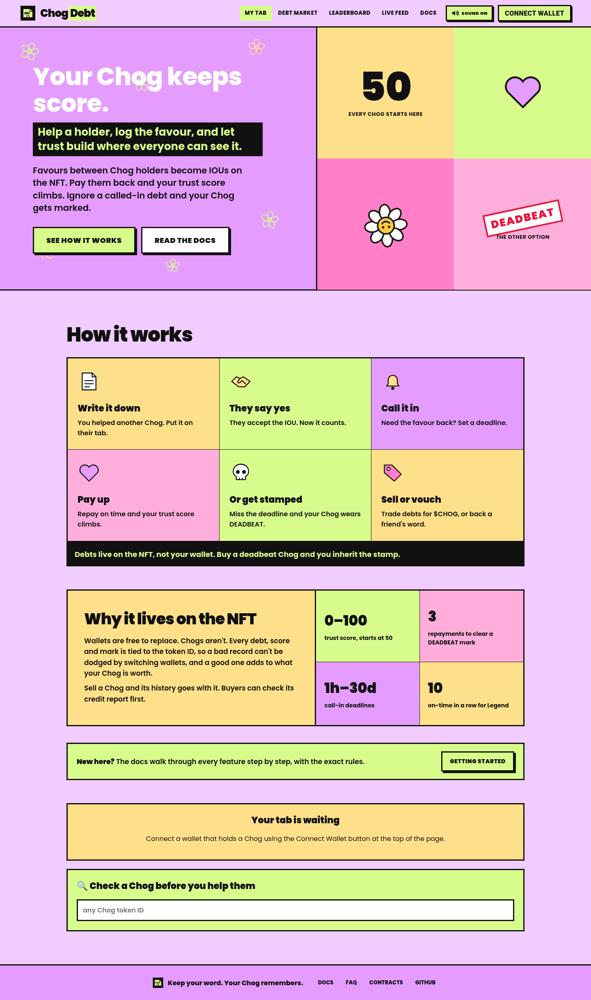
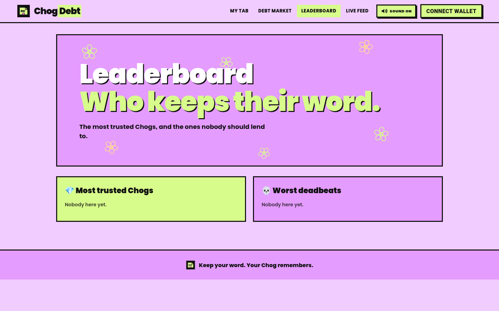
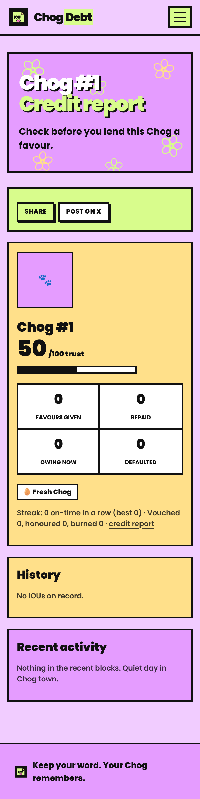

# ChogDebt

ChogDebt keeps a record of favours between Chog holders. When I help you, my Chog writes you an IOU. Once you accept it, your Chog owes mine, and that debt is stored onchain against both Chog NFTs. You can pay it back, I can call it in, and if you ignore a called-in debt past its deadline, your Chog gets a public DEADBEAT mark.

Your Chog becomes your credit score.



## Why I built it

Communities run on favours. Someone reviews your code, makes you a banner, shills your mint, lends you gas. Mostly nobody writes it down, so the people who help get forgotten and the people who never return a favour face no consequences.

I wanted that to have a memory. The Chog community already has a shared identity in the Chog NFT, so that's where the record lives. Anyone can look up a Chog and see whether it keeps its word.

## How it works

1. **Write an IOU.** Pick your Chog, enter the token ID of the Chog that owes you, and add a short note of up to 140 characters, like "designed your banner". You can also ask for some $CHOG as collateral.
2. **They accept it.** Nothing counts until the other holder agrees. They can also reject it, or you can withdraw it before they answer. If you asked for collateral, it's locked in the contract when they accept.
3. **Call it in.** Whenever you need the favour back, you call it in and choose a deadline between 1 hour and 30 days.
4. **They repay.** The debtor marks the favour as returned. Any locked $CHOG goes to whoever holds the creditor Chog at that moment.
5. **Or they default.** Once the deadline passes, anyone can mark the debt defaulted. The debtor's Chog gets the DEADBEAT mark, and the creditor gets the collateral. Repaying three later debts clears the mark, but the default stays in the record.

### Trust score

Every Chog starts at 50, on a scale of 0 to 100.

| What happened | Points |
| --- | --- |
| Repaid a debt | +8 (+2 more if it was repaid after being called in) |
| Gave a favour that was accepted | +3 |
| A Chog you vouched for repaid | +2 |
| Reliable / Legend streak badge | +5 / +10 |
| Defaulted | -25 |
| A Chog you vouched for defaulted | -15 |
| Currently marked as a deadbeat | -10 |

### Streak badges

Each on-time repayment adds to a streak. A repayment is on time if the debt was never called in, or it was paid before the deadline. Three in a row earns **Reliable** and ten earns **Legend**. A late payment or a default resets the streak to zero, but badges you've already earned stay on the Chog.

### Debt trading

If your Chog is owed a favour, you can list that IOU for a price in $CHOG. The buyer's Chog becomes the creditor. That means they get the right to call it in, and any collateral if it defaults. The seller receives the $CHOG. The debtor can't buy their own debt, and if the seller transfers the creditor Chog while the IOU is listed, the listing can no longer be bought.

### Guarantors

A third Chog can vouch for someone else's IOU, and can also stake $CHOG behind it. If the debt is repaid, the guarantor gets the stake back and a small trust boost. If it defaults, the stake goes to the creditor and the guarantor loses 15 trust. A vouch can only be withdrawn before the debtor accepts the IOU.

### Why the debt lives on the NFT

Every debt and every score is tied to the Chog's token ID, not to a wallet address. This matters for three reasons:

- A wallet is cheap to replace and a Chog isn't, so you can't escape a bad reputation by moving to a new wallet.
- If you sell a Chog, its debts, trust score and any DEADBEAT mark go with it. Buyers will check a Chog's credit report before they buy it.
- A Chog with a good record is worth more than one without, which gives everyone a reason to keep their word.

Only the wallet that currently holds a Chog (`ownerOf`) can act for it. You can't write an IOU to your own Chog, or to another Chog held in the same wallet.

## Live contracts (Monad mainnet, chain 143)

| | Address |
| --- | --- |
| ChogDebt v2 | [`0x88e38085753f41cd2ba1248bf9ca30b38768f4f1`](https://monadvision.com/address/0x88e38085753f41cd2ba1248bf9ca30b38768f4f1) (source verified) |
| Chog Genesis NFT | [`0xc96d31F8626c6D03Fae5dCD3d61e3FB9F4a73763`](https://monadvision.com/address/0xc96d31F8626c6D03Fae5dCD3d61e3FB9F4a73763) |
| $CHOG token | [`0x350035555E10d9AfAF1566AaebfCeD5BA6C27777`](https://monadvision.com/address/0x350035555E10d9AfAF1566AaebfCeD5BA6C27777) |

ChogDebt was deployed in block 112186774 ([deploy tx](https://monadvision.com/tx/0x471e49d24ff4435da91b85f2efe33872fcb404eaac1895219c8781ef06c93e5d)). The contract is owned by `0x6c245eAF8F11b05d4220A44CB3F3E8490e5b2Ec1`. The owner can only pause new IOUs, acceptances, call-ins and trades. Repaying and marking defaults keep working while it's paused, so nobody gets stuck. The owner has no way to move anyone's funds.

## The app

<!-- LIVE_URL -->

- **My tab** (`/`): connect a wallet, pick a Chog, and see its trust card. From there you can write IOUs, accept, repay, call in, mark defaults, list debts for sale, and vouch for other Chogs.
- **Debt market** (`/market`): every IOU currently for sale, with the debtor's trust score next to it.
- **Leaderboard** (`/leaderboard`): the most trusted Chogs, and the worst deadbeats.
- **Credit report** (`/chog/<id>`): a shareable page for any Chog, with its score, badges, streak, history and recent activity.
- **Live feed** (`/feed`): recent contract activity, read from events and updated as new ones arrive.

The app plays short sound effects for each action, which you can turn off in the nav. The sounds are generated in the browser, not loaded from files.

<p>
  
  
</p>

## Tech stack

- **Contracts:** Solidity 0.8.24 and Foundry. No external dependencies besides forge-std.
- **Web:** Next.js 15 (App Router), TypeScript, wagmi, viem, RainbowKit and plain CSS. Animations are CSS-only and respect the reduced-motion setting.
- **Chain:** Monad mainnet.

## Project structure

```
contracts/
  src/ChogDebt.sol         the contract
  test/ChogDebt.t.sol      core lifecycle tests
  test/ChogDebtV2.t.sol    trading, guarantors, streaks, leaderboard views
  test/mocks/Mocks.sol     mock ERC-721 and ERC-20
  script/Deploy.s.sol      deploy script
web/
  app/                     pages (home, market, leaderboard, feed, chog/[id])
  lib/                     chain config, ABI, event feed, sound effects
screenshots/
```

## Running it locally

### Contracts

You'll need [Foundry](https://getfoundry.sh).

```sh
cd contracts
forge build
forge test
```

There are 63 tests, and all of them pass. They cover:

- the full IOU lifecycle and who's allowed to do what
- collateral payouts
- deadbeat marks and redemption
- debts, credit and marks moving with the NFT when it's transferred
- debt trading, including stale listings and price limits
- guarantor stakes and penalties
- streaks and badges
- the leaderboard and credit report views

### Web app

```sh
cd web
cp .env.example .env.local
npm install
npm run dev
```

| Variable | Value |
| --- | --- |
| `NEXT_PUBLIC_CHAIN_ID` | `143` (mainnet) or `10143` (testnet) |
| `NEXT_PUBLIC_RPC_URL` | `https://rpc.monad.xyz` |
| `NEXT_PUBLIC_CHOG_DEBT_ADDRESS` | `0x88e38085753f41cd2ba1248bf9ca30b38768f4f1` |
| `NEXT_PUBLIC_CHOG_NFT_ADDRESS` | `0xc96d31F8626c6D03Fae5dCD3d61e3FB9F4a73763` |
| `NEXT_PUBLIC_CHOG_TOKEN_ADDRESS` | `0x350035555E10d9AfAF1566AaebfCeD5BA6C27777` |
| `NEXT_PUBLIC_DEPLOY_BLOCK` | `112186774` |
| `NEXT_PUBLIC_WALLETCONNECT_PROJECT_ID` | your own ID from cloud.reown.com |

Some things to know about how the app reads the chain:

- The Chog contract has no function that lists the tokens in a wallet, so the app asks you for your token IDs and checks `ownerOf` on each one.
- The public RPC returns event logs for at most 100 blocks per request, so the live feed scans back about 3000 blocks and then listens for new events.

## Deploying your own

The deploy script reads `CHOG_NFT` and `CHOG_TOKEN` from the environment. It never handles a private key itself. Use an encrypted Foundry keystore:

```sh
cast wallet import my-deployer --interactive
cd contracts
CHOG_NFT=0xc96d31F8626c6D03Fae5dCD3d61e3FB9F4a73763 \
CHOG_TOKEN=0x350035555E10d9AfAF1566AaebfCeD5BA6C27777 \
forge script script/Deploy.s.sol --rpc-url https://rpc.monad.xyz \
  --account my-deployer --broadcast
```

A deploy costs roughly 5.5M gas. Monad charges for the gas limit you set rather than the gas actually used, so keep about 0.6 MON in the wallet.

## What's next

- A small indexer so the feed and leaderboard can show full history, not just recent blocks.
- Notifications when one of your debts gets called in.
- Group IOUs, where one Chog owes several others for a group favour.
- Letting the debtor and creditor agree to renegotiate a deadline.

## Licence

MIT. See [LICENSE](LICENSE).
